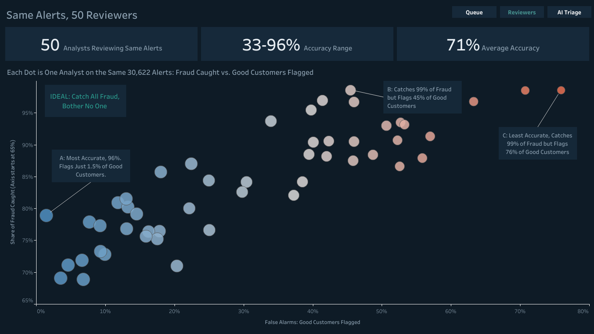
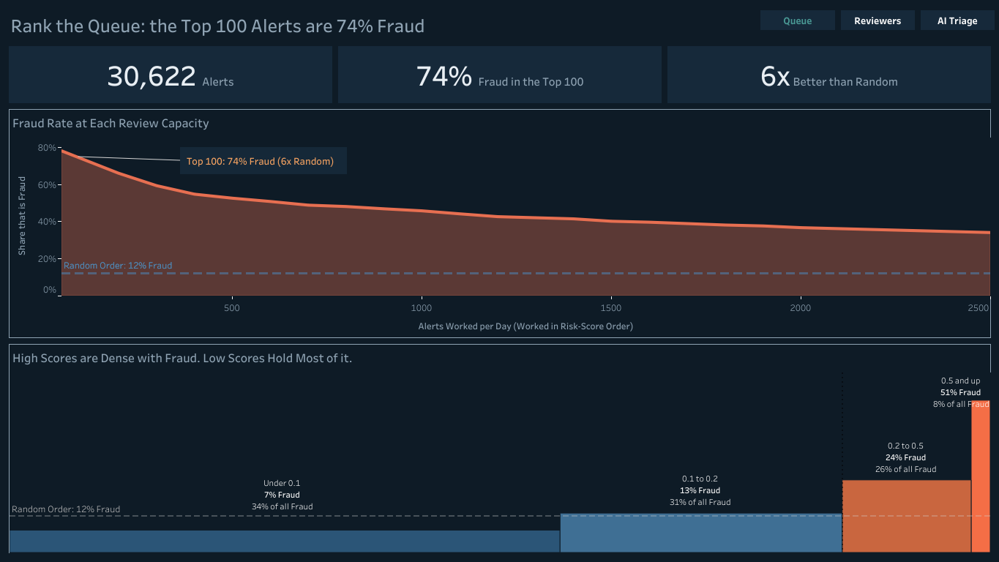
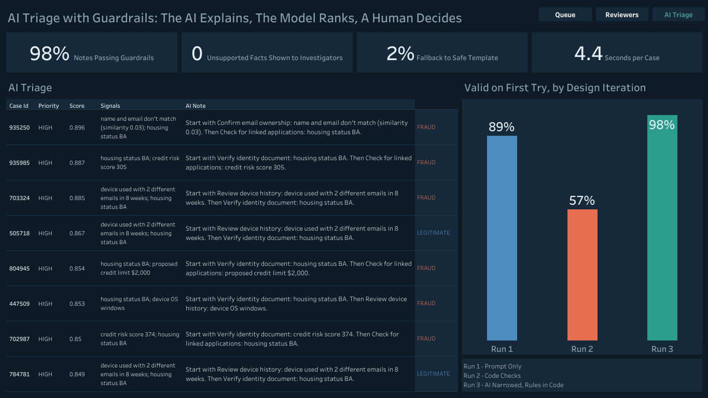

# Fraud Alert Triage: Risk Ranking + a Guardrailed Local AI Assistant

This project looks at **bank account-opening fraud**: rank a queue of fraud alerts by risk, explain each alert in plain English, and use a **local LLM** to draft investigator notes, with checks in code that tie each note's signal list and numbers to the case data, an audit of what those checks missed, and a full audit log. The AI explains; the risk model sets priority; a human decides.

> Synthetic data only (Feedzai BAF / FiFAR). Built to demonstrate fraud-operations analytics and safe AI workflow design, not for real decisions.

**Interactive dashboard (Tableau Public):** [Fraud Alert Triage: Ranking, Reviewers & Guardrailed AI](https://public.tableau.com/app/profile/ray.jack/viz/FraudAlertTriage/1-Queue)



| Queue | AI triage |
|---|---|
|  |  |

## Key results

**1. Ranking the queue matters.** Of 30,622 alerts (12.1% fraud), an investigator working the top 100 by risk score finds **74% fraud**, about **6x** random order (12%).

| Daily review capacity | Fraud rate, risk-ranked | Fraud rate, random order |
|---|---|---|
| 100 | 74% | 12% |
| 500 | 53% | 12% |
| 2,000 | 37% | 12% |

But **two-thirds of the fraud sits in low-score alerts** (score < 0.2, where only 7-13% of cases are fraud), so "only work high scores" misses most of it. That is the capacity vs. coverage trade-off fraud teams manage.

**2. Reviewers vary widely.** Across 50 synthetic analysts, accuracy ranges from **33% to 96%**. One catches 99% of fraud but flags 76% of legitimate applicants; another is 96% accurate, catches 79%, and flags only 1.5%. Consistent case notes are one way to narrow that spread.

**3. The AI triage assistant (local Qwen 2.5 7B via Ollama, Apple M4):** on 250 cases, **98% of AI notes passed every guardrail on the first try**, **0 accepted notes listed a risk signal outside the case's reason codes**, 2% fell back to a deterministic template, median **4.4 s per case**.

| Priority (from risk score) | Cases | Actual fraud rate |
|---|---|---|
| HIGH | 150 | 71% |
| MEDIUM | 9 | 33% |
| LOW | 91 | 12% |

An audit of the accepted notes (`prep/audit_notes.py`) found **19 of 244 (7.8%) still mention a flag the case doesn't have** in the note text, which the checks don't cover: all 19 cite "same-ZIP volume", a phrase the model copied from the prompt's own rule list. Details in [`output/note_audit.md`](output/note_audit.md).

Example note (case 548686, random sample, score 0.07, legitimate):
> Score 0.073, rank 20148 in the queue. Flags: device OS windows; name and email don't match (similarity 0.11); date of birth seen with 3 emails in 4 weeks. *Start with Confirm email ownership: name and email don't match (similarity 0.11). Then Check for linked applications: date of birth seen with 3 emails in 4 weeks.*

More in [`output/sample_cases.md`](output/sample_cases.md).

## How the guardrails evolved (three runs)

| Run | Design | Valid first try | Fallback |
|---|---|---|---|
| 1 | LLM writes summary + sets priority; prompt says "don't invent" | 89% | 2% |
| 2 | Added code checks for unsupported judgments ("low credit score") | 57% | 40% |
| 3 | LLM only sees score, rank and reason codes; facts filled by code; LLM writes a short note; every number must exist in the case | **98%** | **2%** |

Run 1 *looked* fine but most summaries called values "low" or "high", which the anonymized data can't support. Run 2's stricter checks caught that, and also showed the model copying numbers from the prompt's example into real cases. The fix was architectural: **narrow what the LLM is allowed to do and enforce the rules in code instead of trusting the prompt.**

## Guardrails

- **Fixed JSON schema**, one retry, then a deterministic fallback; an unvalidated AI note is never shown.
- **Grounding:** every signal in the structured `risk_signals` list must match the case's own reason codes, and every number in the note must appear somewhere in the case data. Flags written into the note text are not checked (see the audit above), and the number check only looks for each number somewhere in the case data.
- **No value judgments** on anonymized fields (high/low/good/bad), enforced by pattern checks.
- **Approved actions only**; "approve" cannot be combined with investigation steps; an AI approval suggestion on a HIGH-score case is routed to senior review.
- **Priority comes from the risk model, never the LLM.**
- **Audit log** (`output/triage_audit_log.jsonl`): input, prompt hash, model, raw output, validation errors, status, and the human decision for every case.
- **Runs fully local**: no application data leaves the machine.

## Method

1. `prep/score_alerts.py`: XGBoost trained on months 0-2 (397k applications, never the alert months); scores the 30,622 alerts; per-case **reason codes** from TreeSHAP contributions translated to plain language; queue precision at fixed capacity; signal lift.
2. `prep/triage_assistant.py`: the guardrailed LLM assistant (Ollama, `qwen2.5:7b`, temperature 0). A synthetic analyst stands in for the human reviewer.
3. `prep/build_tableau_tables.py`: tables for the Tableau dashboard (`tableau/`), including `score_bands.csv` for the score-band chart.
4. `prep/audit_notes.py`: checks the flags in each accepted note's text against the case's reason codes.

My XGBoost re-ranker (within-alert AUC 0.659) did not beat the dataset's own alert-model score (0.677), so the queue ranks by the provided score and uses my model only for explanations.

## Limitations

- The guardrails check the note's signal list and its numbers, not every flag the note text mentions; 19 of 244 accepted notes cited a flag the case didn't have.
- Synthetic applications and synthetic analysts; some fields are anonymized codes (e.g. housing status "BA"), so several reasons read as codes.
- The 7B model's notes are formulaic and sometimes pair a check with a flag imprecisely; a larger model or a deterministic flag-to-check map would improve this.
- Evaluated on 250 cases (150 top-of-queue + 100 random), not the full alert set.

## Reproduce

```bash
python3 -m venv .venv && source .venv/bin/activate
pip install -r requirements.txt
# download FiFAR (CC BY): https://springernature.figshare.com/articles/dataset/Financial_Fraud_Alert_Review_Dataset/28351172  -> unzip into data_raw/
python prep/score_alerts.py
brew install ollama && ollama serve &   # then: ollama pull qwen2.5:7b
python prep/triage_assistant.py 150 100
python prep/build_tableau_tables.py
python prep/audit_notes.py
```

## Data credit

FiFAR (Financial Fraud Alert Review) dataset (figshare, CC BY license), built on the Bank Account Fraud (BAF) suite by Feedzai (Jesus et al., "Turning the Tables: Biased, Imbalanced, Dynamic Tabular Datasets for ML Evaluation", NeurIPS 2022). This repository is not affiliated with Feedzai.
